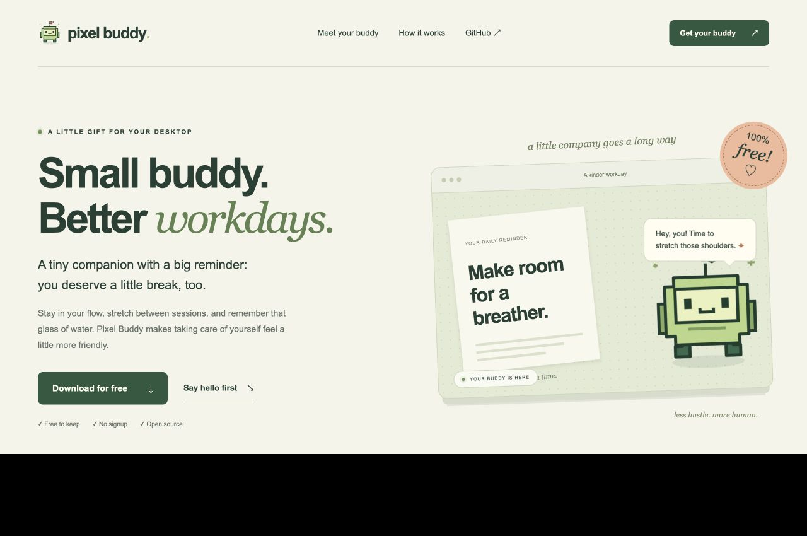

# Pixel Buddy

A free companion for a kinder workday, as a desktop app and a Chrome extension. Pixel Buddy stays near the corner of your screen, leads you through short breaks, and helps you remember your water. No signup or subscription. MIT licensed and free to share.



## Get Pixel Buddy

Get the browser extension on the [Chrome Web Store](https://chromewebstore.google.com/detail/pixel-buddy/ikggibbkgbebflafmlaihlmdpibpdggc), or download a desktop installer from [GitHub Releases](https://github.com/Harshit-Kandoi/pixel-buddy/releases). The promotional website discovers the latest **published** release and shows direct links only for files that exist. Until the first release is published, it shows a clear release status.

| Device | Installer |
| --- | --- |
| Windows x64 | `.exe` |
| macOS Apple silicon | `mac-arm64.dmg` |
| macOS Intel | `mac-x64.dmg` |
| Linux x64 | `.AppImage` or `.deb` |

Desktop installers only; this project does not produce an Android APK.

After the downloader is pushed to `main`, you can download from Bash:

```bash
curl -fsSLo pixel-buddy-download.sh https://raw.githubusercontent.com/Harshit-Kandoi/pixel-buddy/main/scripts/download.sh
bash pixel-buddy-download.sh
```

The script requires Bash, curl, and Python 3.8+. It detects your desktop, downloads the installer, and checks it against the release's `SHA256SUMS`. It never runs the installer or replaces an existing file. Use `--platform windows|mac-arm64|mac-x64|linux|linux-deb` or `--output DIRECTORY` to choose a different target.

These builds have no trusted publisher signature or Apple notarization. macOS Gatekeeper and Windows SmartScreen may warn or block them; checksums do not remove those warnings. Keep operating-system security protections enabled. See [security limitations](docs/code_signing.md) and [checksum verification](docs/releasing.md#verify-a-download). On Linux, give the AppImage execute permission before opening it. Only use this project's official releases.

## Make yourself at home

- Pick Pomodoro (25/5), Balanced (55/5), or Deep focus (90/10), or set your own durations.
- Pause or resume reminders from the timer widget or system tray. Reset clears old cooldowns and starts fresh.
- Use break reminders with snooze and skip controls. Smart monitoring pauses focus while away and recognizes long offline breaks.
- Breaks are guided: the buddy leads a short stretch, a 20-20-20 eye refresh, or a breathing routine, and acts out each step.
- Turn off smart monitoring to use regular timers. In that mode, mouse activity does not interrupt a break.
- Track glasses of water and set your reminder interval. **Dashboard → + Add a glass** logs water you drank away from the computer. Daily counters reset at midnight, including when the app stays open.
- **Dashboard → Share my day** saves or copies a picture of today's focus time, breaks, and water, sized for social posts.
- Limited-time festival buddies: during a festival the buddy turns into that festival's character (New Year, Sankranti & Pongal, Lunar New Year, Eid, Holi, Onam, Halloween, Diwali, Christmas). Take 3 breaks while it lasts to claim it and keep it; otherwise it's gone until next year. Festival dates live in `src/utils/seasons.ts` (mirrored in `website/dist/festivals.mjs`, kept in sync by a test); add future years for the lunar festivals there.
- Start with the illustrated robot mascot. Drop a PNG, GIF, WebP, JPG, AVIF, SVG, MP4, MOV, or WebM onto the buddy, or select one in settings. Use your own alarm sound and colors.
- Preferences and personal media stay in the local app data directory. The app works without a network connection.

On macOS, optional smart monitoring uses Accessibility permission: **System Settings → Privacy & Security → Accessibility → Pixel Buddy**. Without permission, basic system idle detection is used. You can also disable monitoring entirely.

## Develop

Use Node.js 22 LTS with npm.

```bash
npm ci
npm run dev
npm test
npm run build
```

To inspect the actual app UI in a browser without launching Electron:

```bash
npm run app:preview
```

Open `http://127.0.0.1:4180`. The preview uses the real React interface and timer logic, with in-memory settings. It does not validate tray behavior, native mouse tracking, desktop dragging, startup, permissions, or installer behavior. Scene controls let you inspect settings, focus, break and hydration reminders. File and system controls explain that they require the desktop app.

Create installers on the corresponding OS:

```bash
npm run build:win -- --publish never
npm run build:mac -- --publish never
npm run build:linux -- --publish never
```

Artifacts are written to `release/`. Mac packaging produces both Apple silicon and Intel installers. Global input monitoring uses `uiohook-napi`, rebuilt for each target architecture.

## Chrome extension

Pixel Buddy can also live in your browser tabs. The extension runs the same timer logic and interface as the desktop app: one shared timer for every tab, with the buddy in the corner of each page.

**[Add Pixel Buddy to Chrome](https://chromewebstore.google.com/detail/pixel-buddy/ikggibbkgbebflafmlaihlmdpibpdggc)**, free on the Chrome Web Store.

To build it from source:

```bash
npm run ext:build
```

Open `chrome://extensions`, turn on **Developer mode**, choose **Load unpacked**, and select `out/extension`. Run the build again and select the reload button on the extension's card after changes.

To test the built extension end to end before a release:

```bash
npm run ext:test
```

It installs the build into a throwaway headless Chrome profile (your own profile is never touched) and uses it on a real web page with real clicks: the buddy overlay, a guided break, settings and the festival calendar, water logging, the share card, the rating prompt, a real one-minute break, the toolbar popup, and an upgrade from 1.0.0 settings. It takes about 90 seconds; add `-- --quick` to skip the one-minute break. Needs Google Chrome 126 or later (set `CHROME_PATH` if Chrome isn't in the usual place).

- Everything in [Make yourself at home](#make-yourself-at-home) works here too, including guided breaks, festival buddies, water logging (also from the toolbar popup), and Share my day.
- Drag the buddy anywhere; its position is shared across tabs. Clicks pass through the empty space around it.
- The toolbar icon shows minutes until your next break. Its popup opens settings and stats, plus a **Show on pages** switch. In the extension, **Quit Pixel Buddy** hides the buddy from pages until you switch it back on.
- When no visible tab is showing the buddy, break and water reminders arrive as system notifications instead.
- Smart monitoring uses Chrome's idle detection and your activity in browser tabs.
- Custom buddies and alarm sounds are desktop-only for now. The extension uses the built-in robot (with its festive outfits) and chime. Chrome can't show the buddy on its own pages, like `chrome://` pages and the Web Store.

## Releases

Merging to `main` ships a release automatically (`.github/workflows/release-on-merge.yml`):

1. Unit tests and type checks run, then the version goes up in `package.json`, `package-lock.json`, and the extension's `manifest.json`. The bot commits that to `main` as `chore(release): v1.x.y` and tags it.
2. The desktop installers for Windows, both Macs, and Linux are built, the Windows and Mac installers are installed and launched, and the GitHub release is **published** with notes listing the commits since the last release. The website's download buttons pick it up straight away.
3. The Chrome extension gets its end-to-end dry run, and its store zip, `pixel-buddy-extension-<version>.zip`, is attached to the same release. Upload that zip to the Chrome Web Store yourself (see [the store guide](extension/STORE_LISTING.md#releasing-an-update)).

The app, the extension, and the release share one version, in the v1 series:

| In a commit message since the last release | Release |
| --- | --- |
| nothing special | patch: 1.2.0 → 1.2.1 |
| starts with `feat:`, or contains `[minor]` | minor: 1.2.0 → 1.3.0 |
| `[skip release]` in the merge (head) commit | no release |

Website, docs, Markdown, and store-image changes don't trigger a release; the website deploys through its own workflow. Major versions are never automatic. To release by hand, run **Actions → Release on merge → Run workflow** and pick `patch` or `minor`. Preview the next version locally with `node scripts/next-version.mjs`.

**One-time setup on GitHub:** in **Settings → Actions → General → Workflow permissions**, choose **Read and write permissions** so the workflow can push the version commit and tag. If `main` has branch protection or a ruleset, allow GitHub Actions to bypass it, or the version step fails at `git push`. Keep the repository public: the runners are free only for public repositories, and the workflows skip private ones.

Pushing a `v*` tag by hand still works: it builds the same installers and creates a **draft** release for you to publish. See [the release guide](docs/releasing.md) for details, checksum verification, and hosting.

## Promotional website

The buildless, responsive website is in `website/dist/`. It includes an illustrated buddy, an interactive timer and water preview, real release downloads, a copyable Bash command, and installation FAQs. The preview is an illustration of the experience, not a connection to the desktop app.

```bash
npm run site:dev
```

Open `http://localhost:4173`. No website dependencies or build step are needed. The page queries GitHub's public releases API; if GitHub is unavailable or rate-limited, it offers a Releases link instead.

### Deploy to Netlify

The root `netlify.toml` deploys only `website/dist/` and runs `node scripts/check-website.mjs` to validate its assets and links. It overrides the desktop build command and publish directory configured in the Netlify dashboard.

Netlify installs npm dependencies with `--ignore-scripts`, skipping the Electron postinstall rebuild and native dependency install scripts. This website does not need those packages. Desktop dependencies remain in `dependencies` so electron-builder can include them in installers; local development and desktop release workflows keep their normal install and build behavior. Do not use `npm run build` for this static website: that command builds the Electron app.

## Share the freebie

Share the website, the [Chrome Web Store listing](https://chromewebstore.google.com/detail/pixel-buddy/ikggibbkgbebflafmlaihlmdpibpdggc), or [GitHub Releases](https://github.com/Harshit-Kandoi/pixel-buddy/releases). Releases happen on their own when you merge (see [Releases](#releases)); `.github/workflows/website.yml` deploys the promotional site to GitHub Pages once Pages is enabled for GitHub Actions.

Built with Electron, React, TypeScript, and electron-builder. Licensed under [MIT](LICENSE).
